# ドル円4時間足 包み足の型

## レンジ逆張りと順張り押し目 ― 2つの型を16の実例で学ぶ

（著者名）

# はじめに

本書は、ドル円（USDJPY）の4時間足で「包み足」を使う2つの売買ルールをまとめたものです。1つはレンジ相場で高値・安値の「抜け損ない」を狙う逆張りの型、もう1つはトレンド相場で押し目・戻りを狙う順張りの型です。

本書のすべてのルールは、2012年11月から2022年3月までの約9年半のドル円4時間足データで検証しています。数値は最初に決めて固定し、成績を見ながら都合よく調整することはしていません。良い結果だけでなく、負けたトレードや、うまくいかなかった検証結果もそのまま載せています。

先に結論をお伝えします。検証で安定した成績が出たのは「型A：レンジ逆張り」です。「型B：順張り押し目」は、検証期間全体ではわずかにマイナスでした。型Bは、型Aを補う考え方として、成績と注意点を正直に示したうえで紹介します。

ルールは誰が見ても同じ判断になるように作ってあります。チャートを見て「これは型Aか、型Bか、どちらでもないか」を迷わず言えるようになることが、本書のゴールです。

# 本書の前提と用語

## 対象と検証条件

- 通貨ペア：ドル円（USDJPY）
- 時間足：4時間足（1日に6本）
- 検証期間：2012年11月〜2022年3月（約1万4千本）
- スプレッド：0.4pipsとして計算
- 1回のトレードで失う金額：口座残高の1%に固定
- ポジション：同時に持つのは1つまで
- チャートの時刻：データ提供元のサーバー時刻（日本時間ではありません）

## 用語

| 用語 | 意味 |
|---|---|
| pips（ピップス） | ドル円では0.01円＝1pips。1万通貨なら1pipsで約100円の損益 |
| 陽線・陰線 | 終値が始値より高い足が陽線（本書の図では赤）、低い足が陰線（青） |
| 実体 | ローソク足の始値と終値のあいだの太い部分。ヒゲは含まない |
| MA100・MA20 | 直近100本・20本の終値の単純移動平均線（SMA） |
| PF（プロフィットファクター） | 勝ちトレードの利益合計 ÷ 負けトレードの損失合計。1を超えればプラス |
| RR（リスクリワード） | 損切り幅に対する利確幅の倍率。本書の基本はRR2（利確幅＝損切り幅の2倍） |

# 第1章　包み足とは

包み足とは、直前のローソク足の実体を、次の足の実体がすっぽり包み込む2本の組み合わせです。陽線を陰線が包むものを「陰の包み足」、陰線を陽線が包むものを「陽の包み足」と呼びます。

本書では、判定を次のように厳密に決めています。

1. 前の足と、包む側の足の色が逆であること（陽線→陰線、または陰線→陽線）
2. 包む側の足の実体の上端が前の足の実体の上端以上、実体の下端が前の足の実体の下端以下であること
3. 包む側の足の実体が、前の足の実体より大きいこと

ヒゲは判定に使いません。実体だけで見るのは、終値でどちらが勝ったかを重視するためです。たとえば陰の包み足は、「前の足で買い手が押し上げた分を、次の足で売り手がすべて取り返し、さらに押し下げて終わった」ことを意味します。

> **ポイント**
>
> 包み足そのものは、どの相場にもたくさん出てきます。包み足だけで売買しても勝てません。大事なのは「どんな相場の、どこで出た包み足か」です。それを決めるのが次の章の「相場の状態」の見分け方です。

# 第2章　相場の状態をMA100の傾きで見分ける

型Aと型Bのどちらを使うかは、MA100（100本の単純移動平均線）の傾きで決めます。4時間足の100本は約17営業日、ほぼ1か月分の平均値です。

## 傾きの測り方

傾きは次の式で数値にします。

> **MA100の傾き**
>
> （いまのMA100 − 10本前のMA100）÷ 直近14本の平均値幅（高値−安値の平均）

割り算をするのは、相場が荒いときと静かなときで同じ基準を使えるようにするためです。値動きが大きい時期は、MAが同じだけ動いても「傾いている」とは言えません。

| 傾きの値 | 相場の状態 | 使う型 |
|---|---|---|
| −0.5より大きく＋0.5未満 | 横ばい（レンジ） | 型A：レンジ逆張り |
| ＋1.0以上 | 上昇トレンド | 型B：押し目買い |
| −1.0以下 | 下降トレンド | 型B：戻り売り |
| 上記以外（0.5〜1.0の間） | どちらとも言えない | 何もしない |

本書の実例チャートには、左上か左下にこの傾きの値を表示しています。チャートを見てMA100が少し下がっているように見えても、値が−0.5より大きければ「横ばい」と判定します。見た目ではなく数値で決めることで、迷いがなくなります。

> **MT4/MT5で確認するには**
>
> 「挿入 → インディケータ → トレンド → Moving Average」で、期間100・種別Simpleの線を表示します。傾きの数値は、付録のEA（自動売買プログラム）が内部で計算しています。手で確かめる場合は、データウィンドウでMA100の現在値と10本前の値を読み、その差をATR(14)で割ると近い値になります（ATRは前の足の終値も考慮するため、本書の計算とわずかに異なります）。

# 第3章　型A：レンジ逆張り

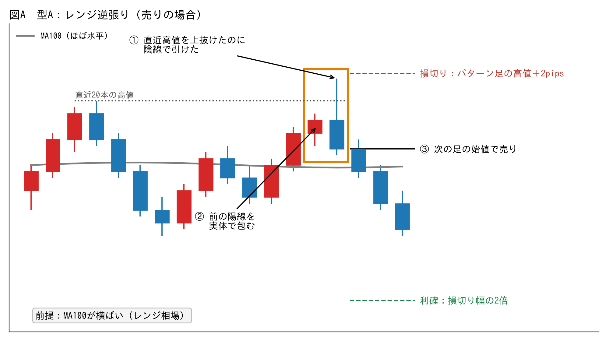

*図A　型Aの模式図（売りの場合）*

## 考え方

レンジ相場では、直近の高値を少し上抜けても、そのまま上昇が続かずに押し戻されることがよくあります。高値更新で買った人の損切りが出て、下げが加速しやすい場面です。型Aは、この「高値更新の失敗」を包み足で確認してから売ります。安値側はその逆で、安値更新の失敗を陽の包み足で確認してから買います。

## 売りの条件（すべて満たしたとき）

1. MA100の傾きが−0.5より大きく＋0.5未満（横ばい）
2. 確定した足の高値が、その直前20本の最高値を上抜けている
3. その足が陰線で、直前の陽線を実体で包んでいる（陰の包み足）

## 買いの条件（すべて満たしたとき）

1. MA100の傾きが−0.5より大きく＋0.5未満（横ばい）
2. 確定した足の安値が、その直前20本の最安値を下抜けている
3. その足が陽線で、直前の陰線を実体で包んでいる（陽の包み足）

## エントリー・損切り・利確

|  | ルール |
|---|---|
| エントリー | 包み足が確定した次の足の始値で成行注文 |
| 損切り | 売りはパターン足の高値＋2pips、買いはパターン足の安値−2pips |
| 利確 | エントリー価格から、損切り幅の2倍の位置（RR2） |
| 決済 | 損切りか利確のどちらかに届くまで持ち続ける。途中で動かさない |

> **検証成績（2012年11月〜2022年3月）**
>
> 取引56回／勝率48.2％／PF 2.09／合計＋1,399pips／口座残高＋27.7％／最大の落ち込み−4.4％。前半（〜2017年）PF 2.68、後半（2018年〜）PF 1.31で、どちらの期間でもプラスでした。損切り幅は中央値で約39pips、ポジションを持つ時間は中央値で6〜7本（約1日）です。

# 第4章　型B：順張り押し目・戻り

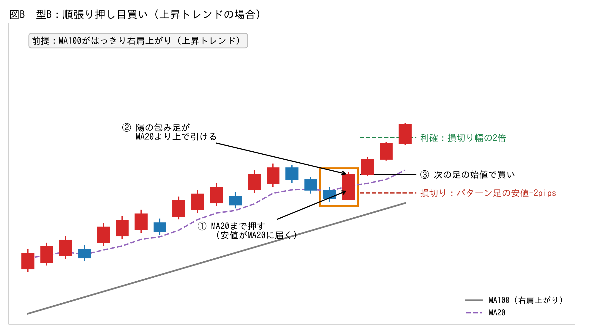

*図B　型Bの模式図（上昇トレンドの押し目買い）*

## 考え方

トレンドがはっきりしている相場では、逆張りは危険です。代わりに、トレンドの途中の一時的な下げ（押し目）が終わったところで、トレンドの方向に乗ります。押し目の目安にMA20を使い、MA20まで下げたあとに陽の包み足でMA20の上に戻したら、押し目が終わったと判断します。

## 買いの条件（すべて満たしたとき）

1. MA100の傾きが＋1.0以上（上昇トレンド）
2. 確定した足の安値がMA20以下まで下げている
3. その足が陽線で、直前の陰線を実体で包み、終値がMA20より上

## 売りの条件（すべて満たしたとき）

1. MA100の傾きが−1.0以下（下降トレンド）
2. 確定した足の高値がMA20以上まで戻している
3. その足が陰線で、直前の陽線を実体で包み、終値がMA20より下

## エントリー・損切り・利確

型Aと同じです。次の足の始値でエントリーし、損切りはパターン足の安値−2pips（売りは高値＋2pips）、利確は損切り幅の2倍です。

> **検証成績（2012年11月〜2022年3月）**
>
> 取引31回／勝率29.0％／PF 0.89／合計−90pips。検証期間全体ではわずかなマイナスでした。内訳は、押し目買いが26回で＋168pips、戻り売りが5回で全敗の−242pips（スプレッドを除いたチャート上の値幅）。検証期間のドル円は円安方向の時期が長く、トレンドに乗る買いは機能した一方、売りはうまくいきませんでした。型Bを使う場合は、この結果を理解したうえで、第7章の注意点を必ず確認してください。

# 第5章　実例集 型A：レンジ逆張り

ここからは実際のチャートで型Aを確認します。勝ちトレード7例と、負けトレード3例を載せています。負けトレードからも学べることが多いので、飛ばさずに読んでください。

> **チャートの見方**
>
> オレンジの枠がパターンの2本、黒い矢印がエントリー、黒線がエントリー価格、赤の破線が損切り、緑の破線が利確です。×印が実際に決済された位置です。灰色の線はMA100、点線は直近20本の高値（安値）です。右側に価格とpips数を表示しています。

## 実例A-1　2013年8月2日　売り　＋150pips（利確）

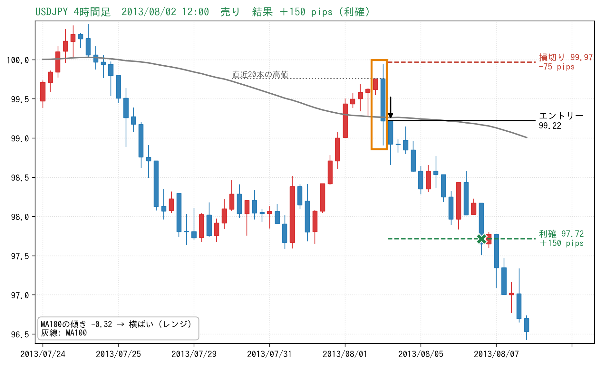

| 項目 | 値 |
|---|---|
| MA100の傾き | −0.32（横ばい） |
| エントリー | 99.22 |
| 損切り | 99.97（−75pips） |
| 利確 | 97.72（＋150pips） |
| 保有 | 13本（約2日） |

97円台から100円手前まで戻したところで、直近20本の高値（約99.77円）を上ヒゲで上抜けました。しかし足が確定してみると、前の陽線を実体ですっぽり包む大きな陰線です。高値を抜けたのは上ヒゲだけで、終値では売り手が勝ちました。

MA100の傾きは−0.32で横ばい判定。次の足の始値で売り、損切りは高値＋2pipsの99.97円、利確は75pips×2の97.72円です。約2日後に利確に届きました。

> **ポイント**
>
> 上ヒゲが長く、実体が大きい陰の包み足ほど「上抜けの失敗」がはっきりしています。型Aの典型的な形です。

## 実例A-2　2015年4月13日　売り　＋144pips（利確）

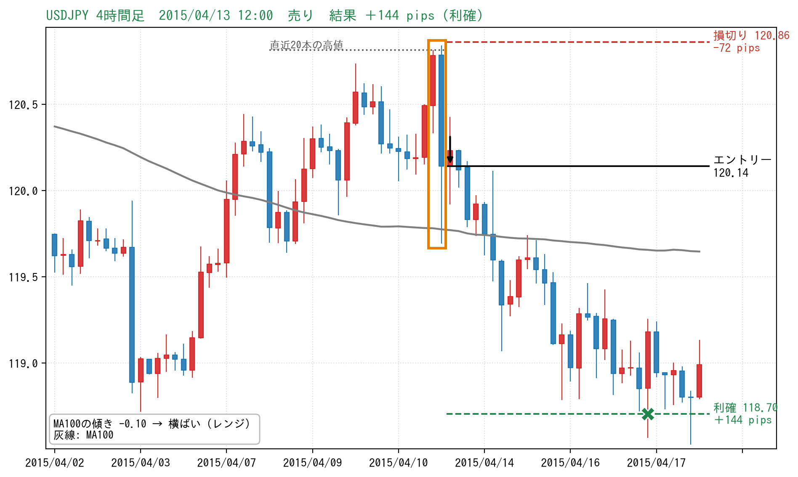

| 項目 | 値 |
|---|---|
| MA100の傾き | −0.10（横ばい） |
| エントリー | 120.14 |
| 損切り | 120.86（−72pips） |
| 利確 | 118.70（＋144pips） |
| 保有 | 24本（約4日） |

120円台後半は数日前にも上値を抑えられた水準です。大陽線で直近高値を上抜けた直後、同じくらいの大きさの陰線がそれを丸ごと包みました。買いの勢いが1本で打ち消された形です。

エントリー後、価格はMA100を割り込んでからいったん戻し、もみ合いながら少しずつ下げていきました。利確まで24本、約4日かかっています。

> **ポイント**
>
> 利確まで時間がかかることはよくあります。途中で損切りや利確の位置を動かさず、ルールどおり待つことが成績を守ります。

## 実例A-3　2015年7月2日　売り　＋126pips（利確）

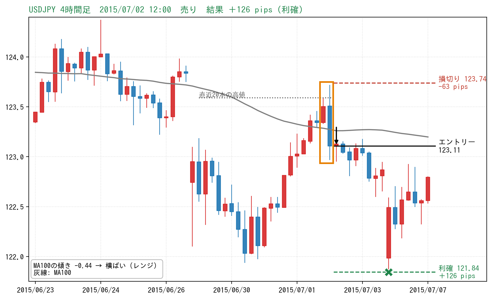

| 項目 | 値 |
|---|---|
| MA100の傾き | −0.44（横ばい） |
| エントリー | 123.11 |
| 損切り | 123.74（−63pips） |
| 利確 | 121.84（＋126pips） |
| 保有 | 9本（約1.5日） |

6月下旬に大きく下げたあと、123円台半ばまで戻してきました。ここは下げる前にもみ合っていた水準で、MA100もすぐ近くにあります。直近高値を上ヒゲで抜けた陰の包み足でエントリーしました。

MA100の傾きは−0.44で、横ばいの境目（−0.5）に近い値です。それでもルール上は型Aなので、迷わず売ります。週明けに大きく下げて利確に届きました。

> **ポイント**
>
> 以前のもみ合い水準やMA100など、上値が重くなりやすい場所で出た包み足は、売り手の勝ちが分かりやすくなります。

## 実例A-4　2015年1月2日　売り　＋105pips（利確）

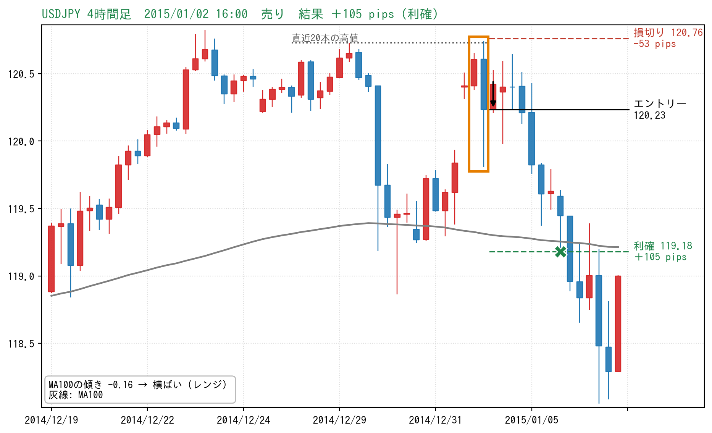

| 項目 | 値 |
|---|---|
| MA100の傾き | −0.16（横ばい） |
| エントリー | 120.23 |
| 損切り | 120.76（−53pips） |
| 利確 | 119.18（＋105pips） |
| 保有 | 8本（約1.5日） |

12月下旬につけた高値（約120.8円）に年明けに再び迫り、上ヒゲで直近高値を超えましたが、陰の包み足で押し戻されました。前回の高値と合わせて、ダブルトップの形になっています。

エントリー後は120円台前半でもたつく時間がありましたが、MA100に向かって下げ、利確に届きました。

> **ポイント**
>
> 前回の高値付近で出た型Aは、ダブルトップと重なるため、チャートを見る人の多くが同じ場所を意識しています。

## 実例A-5　2017年6月14日　買い　＋158pips（利確）

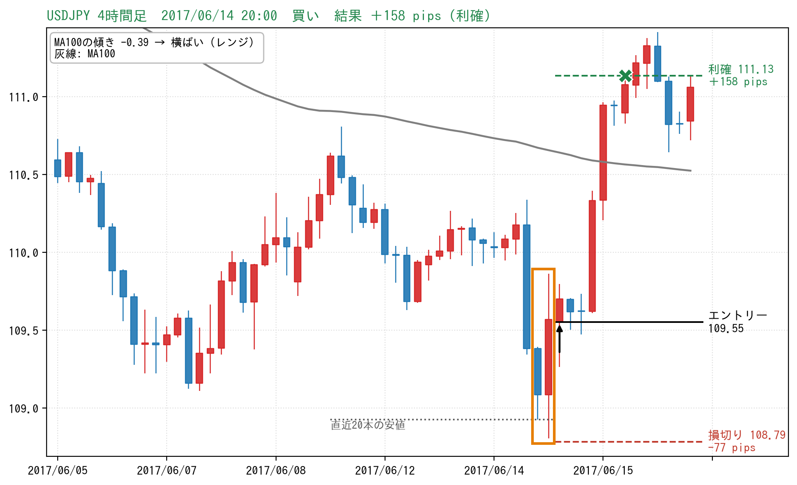

| 項目 | 値 |
|---|---|
| MA100の傾き | −0.39（横ばい） |
| エントリー | 109.55 |
| 損切り | 108.79（−77pips） |
| 利確 | 111.13（＋158pips） |
| 保有 | 7本（約1日） |

大きな陰線で急落し、直近20本の安値を下抜けました。ところが次の足は下ヒゲを残して切り返し、前の陰線を実体で包む陽線で引けました。安値更新が否定された形です。

次の足の始値109.55円で買い。翌日には大陽線でMA100を一気に上抜け、約1日で利確に届きました。

> **ポイント**
>
> 急落の直後は怖く見えますが、安値を割ったあとに陽の包み足で戻したら型Aの買いです。売りの場合と考え方はまったく同じです。

## 実例A-6　2016年3月9日　買い　＋108pips（利確）

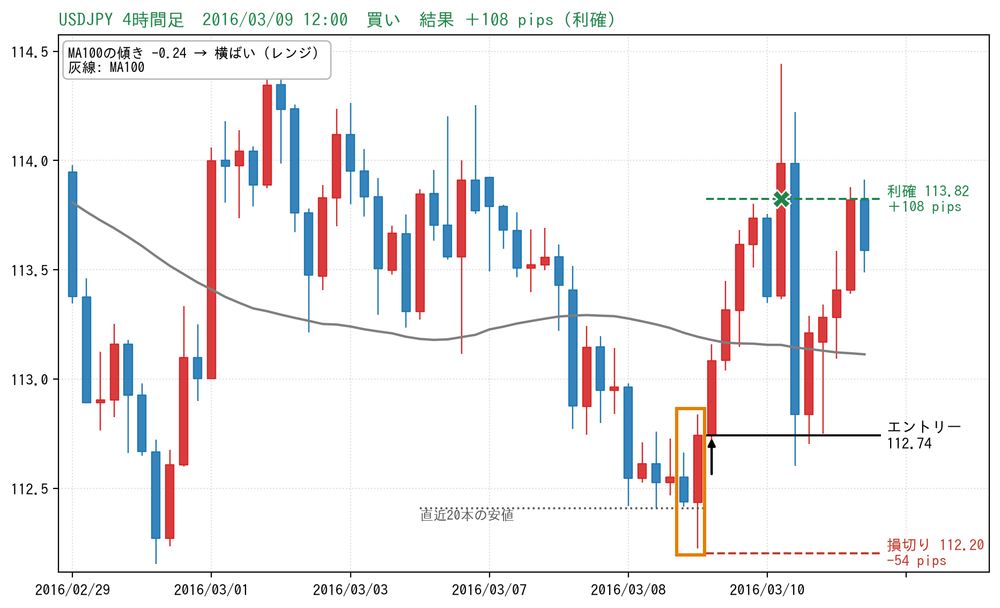

| 項目 | 値 |
|---|---|
| MA100の傾き | −0.24（横ばい） |
| エントリー | 112.74 |
| 損切り | 112.20（−54pips） |
| 利確 | 113.82（＋108pips） |
| 保有 | 6本（1日） |

112円台半ばで小さな足が続いたあと、直近安値を下ヒゲで割り込みました。その足が前の陰線を包む陽線で確定しています。

エントリー後は陽線が続いてMA100を上抜け、1日で利確に届きました。

> **ポイント**
>
> 小さな足が続いて値動きが細っている場面で出た包み足は、損切り幅が小さくなりやすいのも利点です。

## 実例A-7　2018年6月15日　売り　＋83pips（利確）

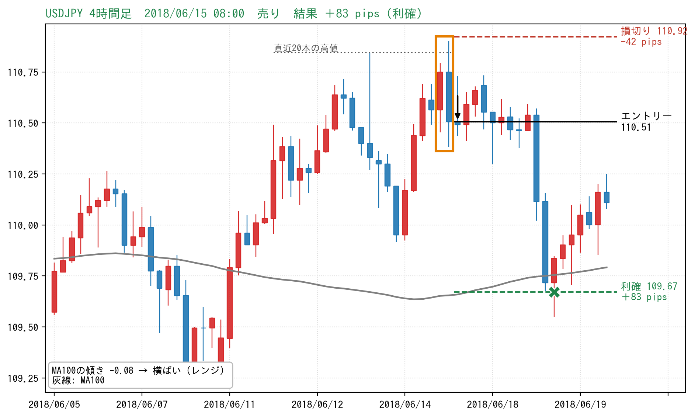

| 項目 | 値 |
|---|---|
| MA100の傾き | −0.08（横ばい） |
| エントリー | 110.51 |
| 損切り | 110.92（−42pips） |
| 利確 | 109.67（＋83pips） |
| 保有 | 12本（2日） |

MA100はほぼ水平（−0.08）。直近高値を上ヒゲで抜けた陰の包み足で売りました。

エントリー後の約2日間は、エントリー価格のすぐ上でもみ合いました。損切りの110.92円には届かず、その後大陰線が出て一気に利確に届いています。

> **ポイント**
>
> エントリー後に動かない時間帯は、手動で決済したくなります。しかし検証の成績は「途中で何もしない」前提のものです。

## 実例A-8　2017年1月5日　買い　−105pips（損切り）

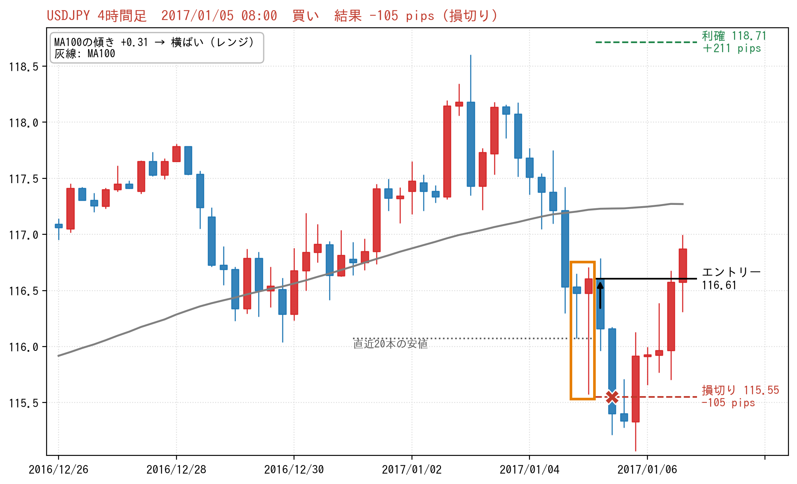

| 項目 | 値 |
|---|---|
| MA100の傾き | ＋0.31（横ばい） |
| エントリー | 116.61 |
| 損切り | 115.55（−105pips） |
| 利確 | 118.71（＋211pips） |
| 保有 | 2本（8時間） |

急落のあと、長い下ヒゲで直近安値を割り込み、小さな陽線で引けました。前の足も実体がごく小さいため、ルール上は陽の包み足です。

問題は損切り幅です。長い下ヒゲの先に損切りを置くため、105pipsと、型Aの中央値（約39pips）の2.7倍になりました。次の足で再び下げ、損切りになりました。

> **この負けから学ぶこと**
>
> 損切り幅が大きくても、ロットを小さくして1回の損失を残高の1%に抑えていれば、損失額は他のトレードと同じです。損切り幅に合わせてロットを決めることが、こうした場面への一番の備えです（第7章Q1）。

## 実例A-9　2017年1月6日　買い　−87pips（損切り）

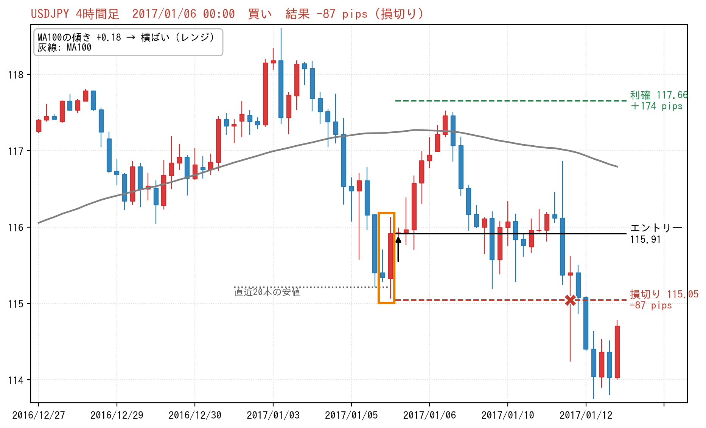

| 項目 | 値 |
|---|---|
| MA100の傾き | ＋0.18（横ばい） |
| エントリー | 115.91 |
| 損切り | 115.05（−87pips） |
| 利確 | 117.66（＋174pips） |
| 保有 | 23本（約4日） |

実例A-8の直後、同じ安値圏で再び陽の包み足が出ました。エントリー後は順調に上がり、117.5円付近まで上昇しましたが、利確の117.66円にあと十数pips届かずに反転しました。

その後はじりじりと下げ、4日後に損切りになりました。A-8と合わせて2連敗です。

> **この負けから学ぶこと**
>
> 利確の手前で反転するのはつらいものです。利確を損切り幅の1倍（RR1）にすると勝率は上がり、このトレードも勝ちになっていました。どちらを選ぶかは第7章Q4で検証データと一緒に説明します。

## 実例A-10　2019年6月7日　売り　−65pips（損切り）

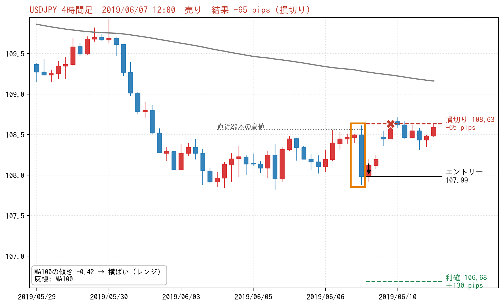

| 項目 | 値 |
|---|---|
| MA100の傾き | −0.42（横ばい） |
| エントリー | 107.99 |
| 損切り | 108.63（−65pips） |
| 利確 | 106.68（＋130pips） |
| 保有 | 4本（16時間） |

MA100よりかなり下で、もみ合いの高値を上ヒゲで抜けた大陰線の包み足です。大陰線がほぼ安値で引けたため、エントリーはすでに大きく下げたあとの位置になりました。

エントリーは金曜日。週明けに買い戻され、損切りに届きました。

> **この負けから学ぶこと**
>
> 大陰線の安値付近でのエントリーは、その後の戻りで損切りに届きやすくなります。また、週末をまたぐと月曜の窓開けで想定外の値段になることがあります（第7章Q6）。

# 第6章　実例集 型B：順張り押し目・戻り

型Bの実例です。勝ちトレード4例と負けトレード2例を載せています。チャートには、灰色のMA100に加えて、紫の破線でMA20を表示しています。

## 実例B-1　2014年11月11日　買い　＋137pips（利確）

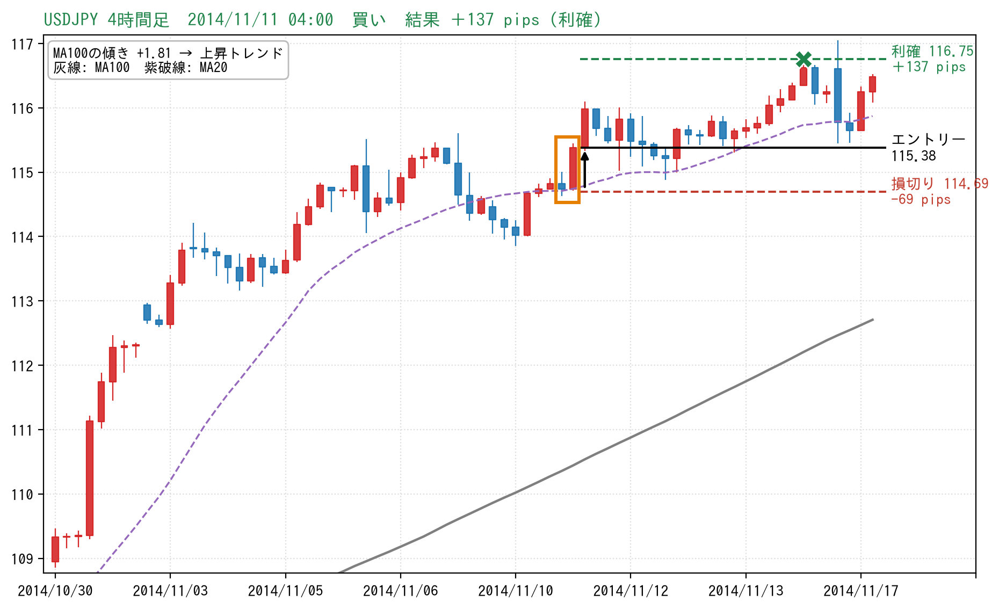

| 項目 | 値 |
|---|---|
| MA100の傾き | ＋1.81（上昇トレンド） |
| エントリー | 115.38 |
| 損切り | 114.69（−69pips） |
| 利確 | 116.75（＋137pips） |
| 保有 | 20本（約3日） |

2014年10月31日の日銀の追加緩和をきっかけに、ドル円は109円台から115円台まで急上昇しました。その後、MA20まで押したところで陽の包み足が出て、終値はMA20の上です。

エントリー後はMA20に沿ってゆっくり上昇し、約3日で利確に届きました。

> **ポイント**
>
> 強いトレンドの最初の押し目は、型Bが最も機能しやすい場面です。MA100の傾きも＋1.81と大きく、トレンドがはっきりしています。

## 実例B-2　2015年6月3日　買い　＋112pips（利確）

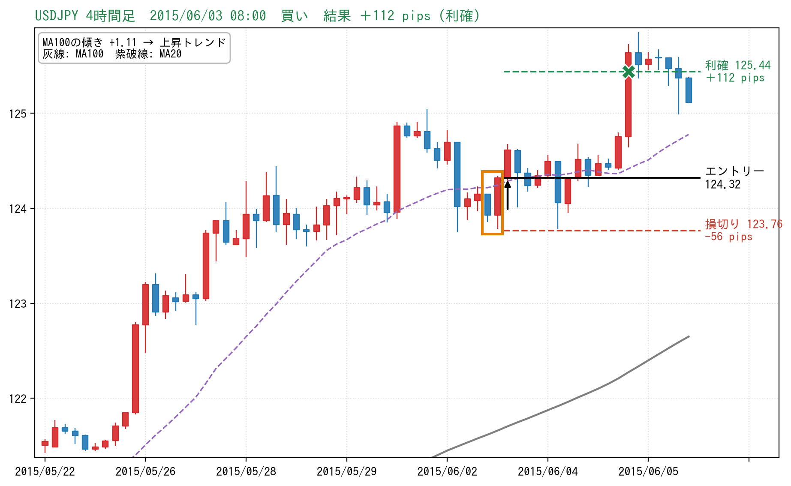

| 項目 | 値 |
|---|---|
| MA100の傾き | ＋1.11（上昇トレンド） |
| エントリー | 124.32 |
| 損切り | 123.76（−56pips） |
| 利確 | 125.44（＋112pips） |
| 保有 | 13本（約2日） |

5月下旬の上昇のあと、大きな陰線でMA20付近まで押しました。小さな陰線のあと、陽の包み足でMA20の上に戻しています。

エントリー後はしばらくもみ合いましたが、MA20を割り込まずに推移し、大陽線で利確に届きました。

> **ポイント**
>
> エントリー後もMA20の上で推移しているあいだは、トレンドが続いていると考えられます。

## 実例B-3　2016年10月21日　買い　＋85pips（利確）

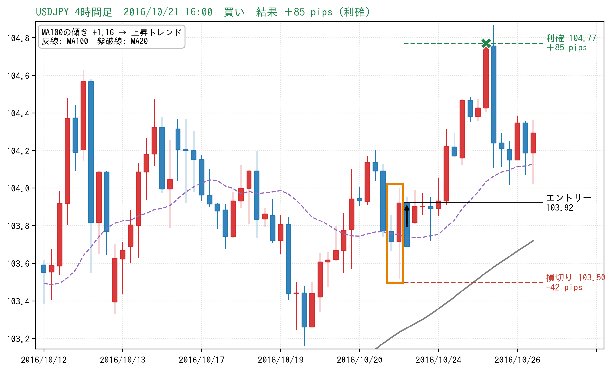

| 項目 | 値 |
|---|---|
| MA100の傾き | ＋1.16（上昇トレンド） |
| エントリー | 103.92 |
| 損切り | 103.50（−42pips） |
| 利確 | 104.77（＋85pips） |
| 保有 | 11本（約2日） |

長い下ヒゲでMA20を割り込んだあと、陽の包み足でMA20の上に戻しました。

エントリー直後の足は陰線で、エントリー価格より20pips以上下げています。それでも損切り（103.50円）には届かず、その後上昇して利確しました。

> **ポイント**
>
> エントリー直後の逆行で慌てて決済すると、このトレードは負けになっていました。損切りの位置はエントリー前に決めてあるので、そこに届くまでは何もしません。

## 実例B-4　2016年12月5日　買い　＋187pips（利確）

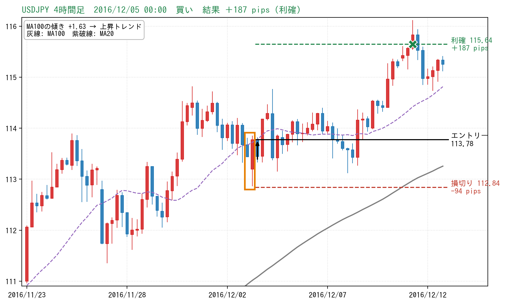

| 項目 | 値 |
|---|---|
| MA100の傾き | ＋1.63（上昇トレンド） |
| エントリー | 113.78 |
| 損切り | 112.84（−94pips） |
| 利確 | 115.64（＋187pips） |
| 保有 | 32本（約5日） |

2016年11月の米大統領選挙のあと、ドル円は強い上昇トレンドになりました。12月初めにMA20まで押したところで、長い下ヒゲの陽の包み足が出ています。

エントリー後は3日ほどエントリー価格の近くでもみ合いましたが、その後大きく上昇し、約5日で利確に届きました。

> **ポイント**
>
> 損切り幅が94pipsと大きめなので、ロットは小さくなります。それでも利確幅は2倍の187pipsなので、損失1%に対して利益は2%です。

## 実例B-5　2016年12月22日　買い　−37pips（損切り）

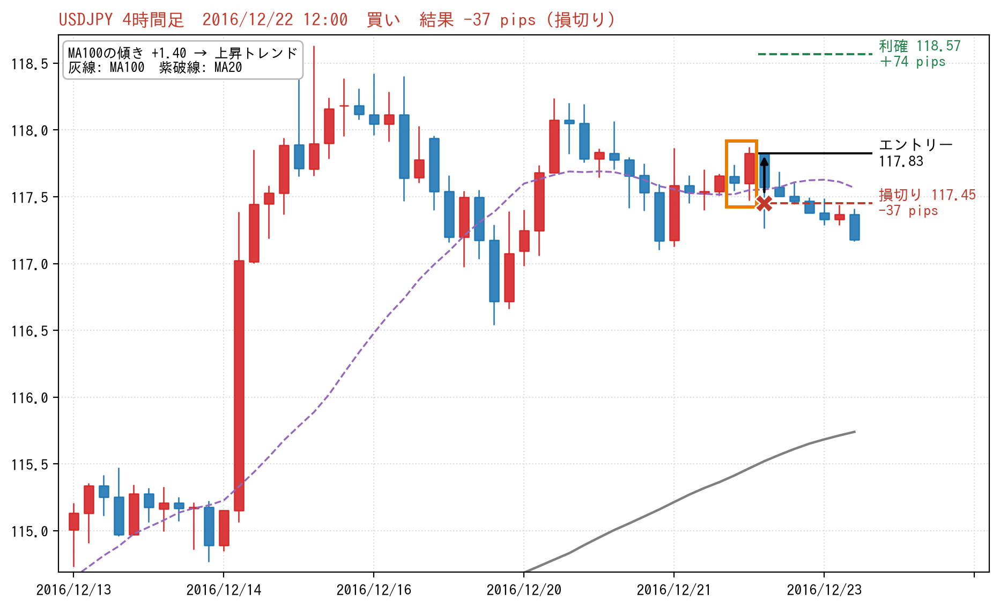

| 項目 | 値 |
|---|---|
| MA100の傾き | ＋1.40（上昇トレンド） |
| エントリー | 117.83 |
| 損切り | 117.45（−37pips） |
| 利確 | 118.57（＋74pips） |
| 保有 | 1本（4時間） |

MA100の傾きは＋1.40で、数値の上では上昇トレンドです。しかし12月15日の高値（約118.6円）を超えられず、MA20もほぼ水平になっていました。上昇の勢いが弱まっている状態です。

陽の包み足でエントリーしましたが、次の足ですぐに下げ、損切りになりました。

> **この負けから学ぶこと**
>
> MA100はゆっくりしか動かないため、トレンドの終わりにも「上昇トレンド」と判定し続けます。直近の高値を更新できず、MA20が横ばいになっている場面は、トレンドが弱まっているサインと考えられます（第7章Q8）。

## 実例B-6　2017年4月5日　売り　−79pips（損切り）

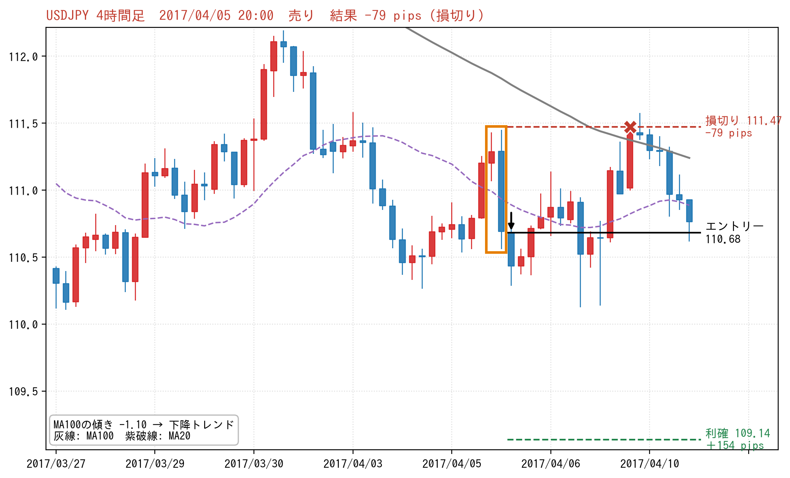

| 項目 | 値 |
|---|---|
| MA100の傾き | −1.10（下降トレンド） |
| エントリー | 110.68 |
| 損切り | 111.47（−79pips） |
| 利確 | 109.14（＋154pips） |
| 保有 | 13本（約2日） |

下降トレンドの中で、MA20まで戻したところで陰の包み足が出たため、戻り売りをしました。

ただ、このとき価格はすでにMA100から大きく下に離れていました。エントリー後は下げきれずにもみ合い、MA100に向かって戻す上昇で損切りになりました。

> **この負けから学ぶこと**
>
> 検証期間の戻り売りは5回すべて負けています。MA100から大きく離れた位置での戻り売りは、MA100までの戻りに巻き込まれやすい形です（第7章Q7）。

# 第7章　こんな場合はどうする？

実例で出てきた迷いやすい場面と、その対処法をまとめます。「検証済み」と書いたものは、本書の検証データで確認した内容です。それ以外は、検証していない実践上の考え方です。採用する場合は、ご自身でもデモ口座などで確かめてください。

### Q1　損切り幅がいつもより大きい（100pips近い）

ロットを小さくして、1回の損失を残高の1%に合わせてください。たとえば口座が100万円なら1%は1万円です。損切り幅が50pipsなら1pipsあたり200円、つまり2万通貨です。損切り幅が100pipsなら1pipsあたり100円で、1万通貨になります。損切り幅がいくつでも損失額は同じになるので、ルールどおりに続けられます（実例A-8、B-4）。

### Q2　包み足の実体が小さく、ヒゲばかり長い

本書のルールでは、条件を満たしていればエントリーします。検証の成績もそれを含んだものです。もし「実体が小さいものは見送る」と決める場合は、その場の気分ではなく、エントリーする前に基準を決めておいてください。なお、この見送りルールは本書では検証していません。

### Q3　同じ方向のサインが続けて出て、連敗した

検証期間中の最大連敗は、型Aで4回、型Bで6回でした。実例A-8とA-9のような2連敗は、ルールの範囲内で普通に起こります。1回の損失を1%に抑えていれば、4連敗しても残高の減少は約4%です。連敗中にロットを増やして取り返そうとするのは避けてください。（検証済み）

### Q4　利確の手前で反転してしまう

利確を損切り幅の何倍にするかは、勝率と1回の利益のバランスで決まります。型Aを利確の倍率だけ変えて検証した結果は次のとおりです。（検証済み）

| 利確の位置 | 勝率 | PF | 合計pips | 最大の落ち込み |
|---|---|---|---|---|
| 損切り幅の1倍 | 66.1％ | 2.10 | ＋941 | −3.1％ |
| 損切り幅の1.5倍 | 55.4％ | 2.17 | ＋1,261 | −4.4％ |
| 損切り幅の2倍（基本） | 48.2％ | 2.09 | ＋1,399 | −4.4％ |

PFはどれもほぼ同じです。勝率の高さで安心したい人は1倍、最終的な利益を大きくしたい人は2倍、というように、自分が続けやすい方を選んでください。大事なのは、選んだ倍率を途中で変えないことです。

### Q5　MA100の傾きが境目ぎりぎり

数値どおり機械的に判定してください。実例A-3（−0.44）やA-10（−0.42）は境目の近くですが、ルールどおり型Aとして扱っています。境目で迷い始めると、判断が都合よく変わってしまいます。数値で決めること自体が、このルールの大事な部分です。

### Q6　金曜日や、重要な経済指標・会合の前にサインが出た

週末をまたぐと、月曜日の始値が金曜日の終値から大きく離れる（窓が開く）ことがあります。その場合、損切りの価格より不利な値段で決済されることがあります。2016年4月28日の日銀会合の日には、型Aの売りで損切り幅が300pipsになるほど大きな足が出ました（結果は約2か月後に＋600pipsで利確）。大きなイベントの前はロットを通常より小さくする、または見送るという考え方もあります。ただし、本書の検証ではそうしたトレードも含めて成績を出しています。この対処法は検証していません。

### Q7　型Bで、価格がMA100から大きく離れている

実例B-6のように、MA100から大きく離れた位置での戻り売り・押し目買いは、MA100へ戻る動きに巻き込まれやすくなります。検証期間の戻り売りは5回すべて負けでした。型Bは押し目買いを中心に考え、戻り売りは特に慎重に判断することをおすすめします。この判断方法は検証していません。

### Q8　型Bで、トレンドの勢いが落ちてきた

MA100の傾きはゆっくりしか変わらないため、トレンドの終盤でも上昇トレンドと判定されることがあります（実例B-5）。直近の高値を更新できていない、MA20が横ばいになってきた、といった場面では、型Bのサインを見送るのも1つの考え方です。この見送り方は検証していません。

### Q9　エントリー直後に逆行した

損切りの位置に届くまで何もしないでください。実例B-3では、エントリー直後に20pips以上逆行してから利確に届きました。検証の成績は、エントリー後に手を加えない前提で出したものです。

### Q10　サインに気づくのが遅れた

エントリーは「次の足の始値」が前提です。気づいたときに価格が始値から大きく離れていると、損切り幅と利確幅の比率が崩れます。始値から離れている場合は、そのサインは見送るのが無難です。次のサインは必ず来ます。この見送り方は検証していません。

# 第8章　検証データと資金管理

## 型別の成績

|  | 取引回数 | 勝率 | PF | 合計 |
|---|---|---|---|---|
| 型A（全期間） | 56回 | 48.2％ | 2.09 | ＋1,399pips |
| 型A（〜2017年） | − | − | 2.68 | 残高＋21.3％ |
| 型A（2018年〜） | − | − | 1.31 | 残高＋3.2％ |
| 型B（全期間） | 31回 | 29.0％ | 0.89 | −90pips |
| 型B（〜2017年） | − | − | 0.97 | 残高−3.4％ |
| 型B（2018年〜） | − | − | 0.59 | 残高−1.2％ |

条件：ドル円4時間足、2012年11月〜2022年3月、スプレッド0.4pips、1回のリスクは残高の1%、利確は損切り幅の2倍。

## 知っておいてほしいこと

- 型Aの合計＋1,399pipsのうち、約600pipsは2016年4月28日（日銀会合の日）の1回で得たものです。この1回を除くと合計は約＋800pips、PFは約1.6です。1回の大きな勝ちに頼らなくてもプラスですが、数字の見え方は変わります。
- 型Aの成績は後半（2018年〜）にPF 1.31まで下がっています。プラスは保っていますが、前半ほどの成績ではありません。
- 型Aをユーロドル・ポンドドル・ゴールドなど他の11銘柄の4時間足でも検証しました。前半・後半ともにPFが1を超えたのはドルカナダ（後半1.05）だけで、ほとんどの銘柄では再現しませんでした。本書の型は、ドル円4時間足での検証結果に基づくものです。
- ドル円で時間足を1時間足・5分足・1分足に短くすると、スプレッドの負担が大きくなり、成績はマイナスか、期間によって安定しませんでした。
- 過去の検証結果は、将来の成績を約束するものではありません。

## 資金管理の3つのルール

1. 1回の損失は残高の1%まで。損切り幅からロットを計算する
2. 損切りと利確は、エントリーと同時に注文しておく
3. 連敗しても、ロットを増やして取り返そうとしない

# 付録　EA（自動売買）の設定

本書のルールは、MT4用とMT5用のEA「RegimeSwitchEA」として作ってあります。ドル円の4時間足チャートに設定してください。主な設定は次のとおりです。

| 設定名 | 初期値 | 内容 |
|---|---|---|
| MAPeriod | 100 | 相場の状態を判定するMAの期間 |
| FlatATR | 0.5 | 傾きがこの値未満なら横ばい（型A） |
| TrendATR | 1.0 | 傾きがこの値以上ならトレンド（型B） |
| UseRange | true | 型Aを使う |
| UseTrend | true | 型Bを使う。型Aだけにするならfalse |
| Lookback | 20 | 型Aで基準にする直近の本数 |
| RangeRR / TrendRR | 2.0 | 利確の倍率（損切り幅の何倍か） |
| RiskPercent | 1.0 | 1回の損失（残高の%） |

検証成績から考えると、まずは型Aだけ（UseTrend＝false）で、デモ口座から始めることをおすすめします。

# おわりに

包み足は、どのFXの本にも出てくる基本的な形です。本書で伝えたかったのは、形そのものより「どの相場で、どこに出た包み足か」を数値で決めることの大切さです。同じ包み足でも、レンジ相場の高値で出れば勝ちやすく、トレンドに逆らって出れば負けやすい。それが約9年半のデータが示した答えでした。

ルールを守り、損失を小さく固定し、淡々と繰り返す。地味ですが、それが一番の奥義だと考えています。

免責事項：本書は情報提供を目的としたものであり、特定の金融商品の売買を勧めるものではありません。FX取引には元本を超える損失が生じる可能性があります。投資の判断はご自身の責任で行ってください。本書の検証データは、GitHubで公開されている過去の価格データ（ejtraderLabs/historical-data）を使用しています。
